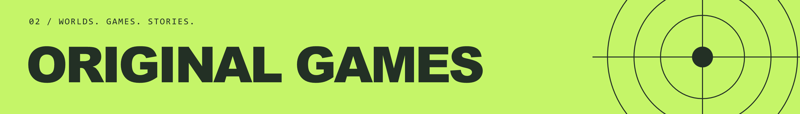

**We combine creative direction, software engineering, and visual production to build experiences across physical and digital spaces.**

Our work spans interactive installations, immersive environments, custom applications, real-time simulation, and original games.

## What we build

- **Real-time 3D & simulation**: virtual environments, simulators, and interactive configurators.
- **Applications & digital systems**: web and mobile applications, dashboards, and control interfaces.
- **Interactive & immersive experiences**: installations, spatial interaction, and AR, VR, and MR.
- **Games & gamification**: original games, gameplay systems, and interactive learning.
- **Visual production & workflows**: generative visual workflows and Unreal Engine environments with real-time scenography controls.

We bring design, development, and production together, from the initial concept to the working experience.

## Original games

Through **Seven Heroes Indie**, we develop independent games with distinctive ideas, focused scope, and sustainable production.

**Currently in development**

- **We'll Be Before Us**: a sci-fi puzzle game built around fractured time and cooperation with past versions of yourself.
- **Hollow Skies**: a post-apocalyptic drone exploration and survival game built around flight, recovery, and customization.

[sevenheroes.it](https://www.sevenheroes.it) · [direzione@sevenheroes.it](mailto:direzione@sevenheroes.it)
