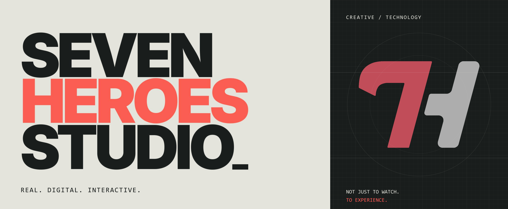
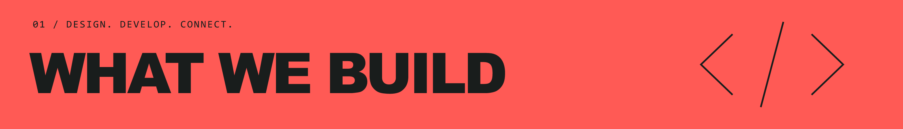
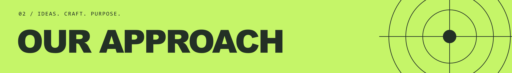
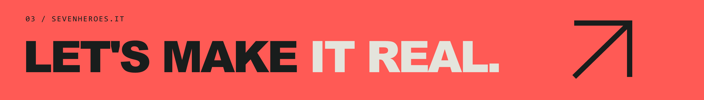

**Seven Heroes Studio brings together creative direction, software engineering, and visual production to build experiences across physical and digital spaces.**

We design and develop bespoke installations, immersive environments, applications, and real-time simulations for businesses and institutions, alongside our own original projects.

## What we build

- **Real-time 3D & simulation**: virtual environments, simulators, and interactive configurators.
- **Applications & digital systems**: web and mobile applications, dashboards, and control interfaces.
- **Interactive & immersive experiences**: installations, spatial interaction, and AR, VR, and MR.
- **Experience design & engagement**: interactive learning, participation, and progression systems.
- **Visual production & workflows**: generative visual workflows and Unreal Engine environments with real-time scenography controls.

We bring design, development, and production together, from the initial concept to the working experience.

## Our approach

We believe in strong ideas with a clear identity. Our multidisciplinary experience brings creative direction, technical development, and production together from the start, giving each project a coherent vision and a practical path to delivery.

We balance creative ambition with focused scope and sustainable production. Whether developing an original concept or a bespoke experience, we shape the work around its purpose, audience, and available resources, with the same care for the idea and its execution.

[sevenheroes.it](https://www.sevenheroes.it) · [direzione@sevenheroes.it](mailto:direzione@sevenheroes.it)
